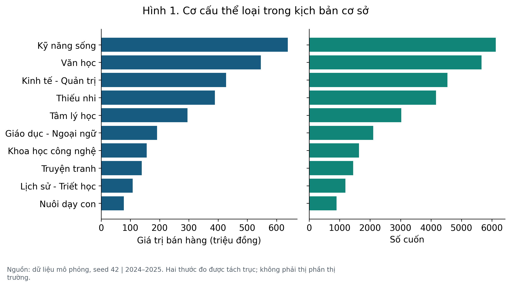
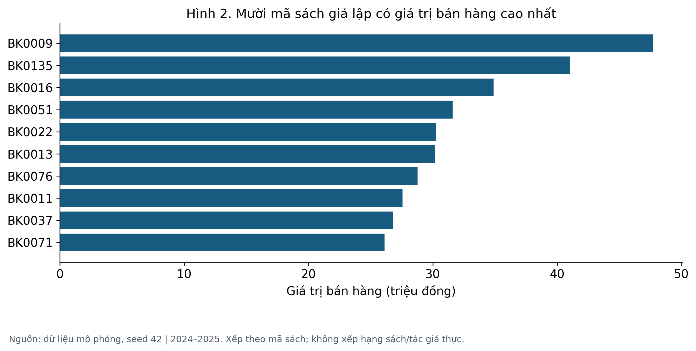
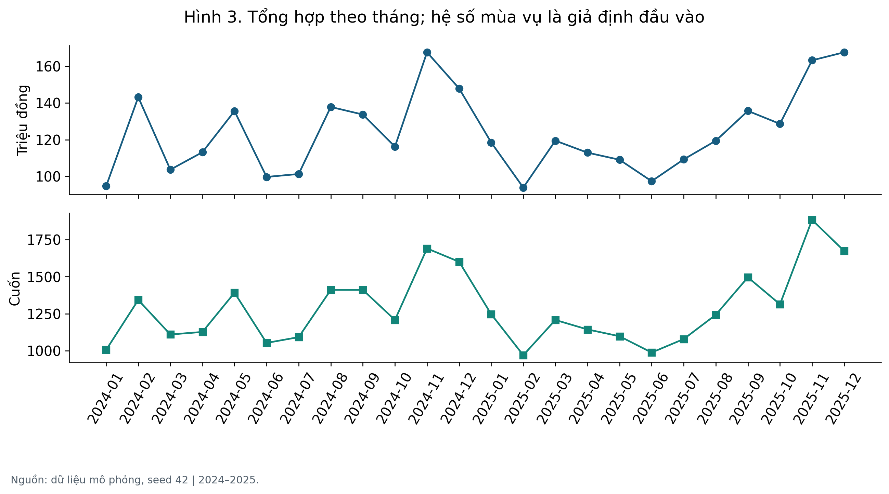
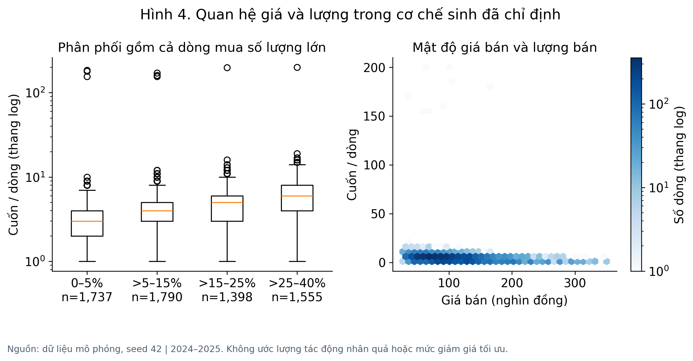
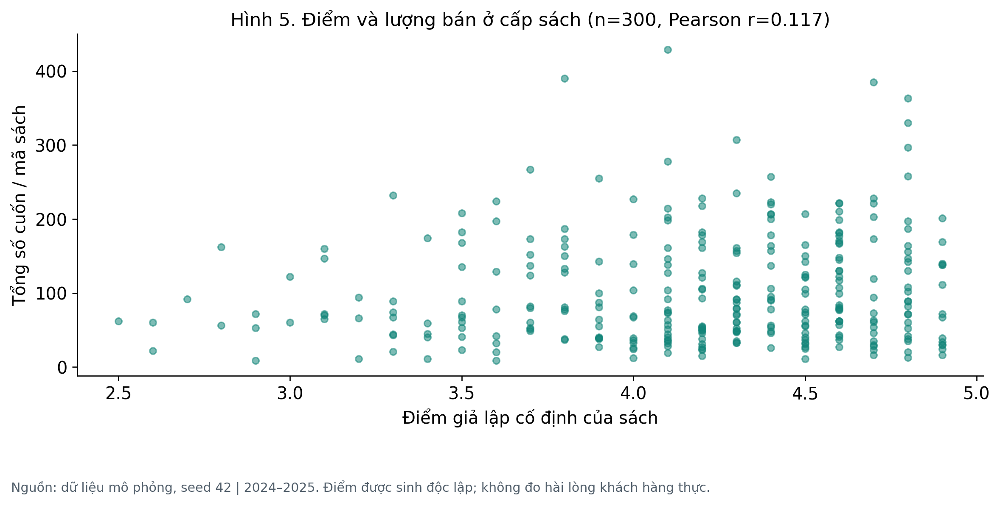
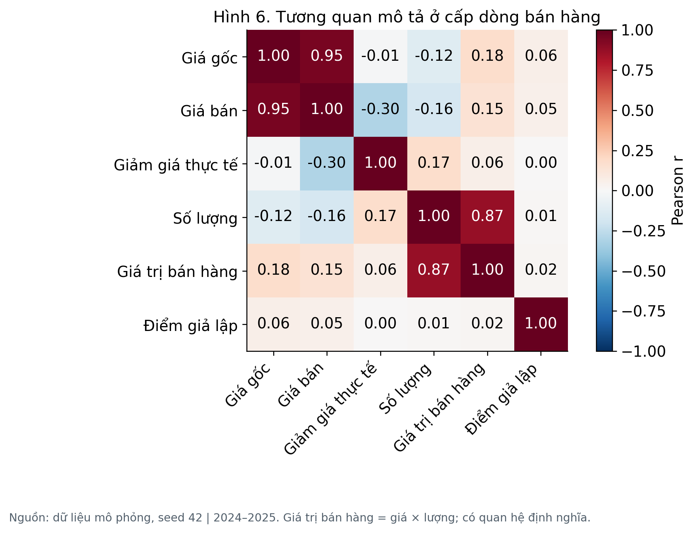
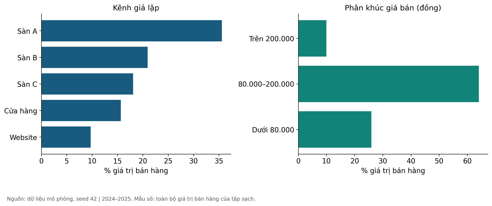
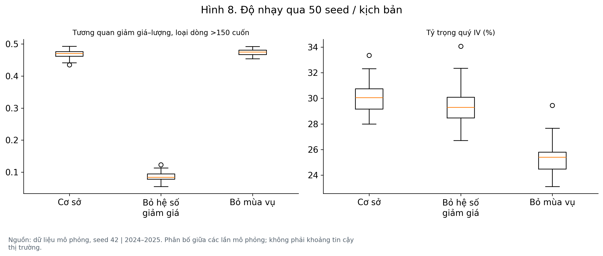

# Xây dựng và phân tích bộ dữ liệu kinh doanh sách

NGHIÊN CỨU MÔ PHỎNG CÓ KIỂM CHỨNG • NHẬP MÔN KHOA HỌC DỮ LIỆU

Bản nghiên cứu phục vụ học phần, ngày 08/11/2026. Thời gian được mô phỏng: 01/2024–12/2025. Tên sách, tác giả, nhà xuất bản, kênh bán và toàn bộ giao dịch đều giả lập. Không sử dụng dữ liệu giao dịch của doanh nghiệp hay khách hàng thật.

Tóm tắt. Đề tài xây dựng 6.500 đơn một đầu sách từ danh mục 300 sách giả lập, chủ động thêm lỗi để tạo 6.660 dòng thô. Quy trình chuẩn hóa, đối chiếu danh mục và xử lý mã dòng thu được 6.480 dòng phân tích. Các trường được đối chiếu trên tập giữ lại khớp dữ liệu chuẩn; tuy nhiên giá trị bán hàng toàn kỳ vẫn chênh -0,306% do cách ly bản ghi. Điều này cho thấy tính đúng của từng dòng giữ lại khác với độ đầy đủ của toàn bộ dữ liệu.

Kết quả mô tả của kịch bản cơ sở: 2.969.430.000 đồng giá trị bán hàng, 30.790 cuốn và 300 mã sách có phát sinh bán. Ba kịch bản được lặp 50 lần để xem kết quả thay đổi khi bỏ hệ số khuyến mãi hoặc mùa vụ. Các khác biệt thu được chỉ đánh giá hành vi mô hình dưới giả định, không xác nhận quy luật thị trường Việt Nam.

Đóng góp thực hành là một quy trình có thể chạy lại: dữ liệu thô và chuẩn tách biệt; quy tắc làm sạch có nhật ký; số liệu báo cáo lấy từ bảng kết quả; biểu đồ, dashboard và notebook dùng chung hàm phân tích. Nhóm cần bổ sung thông tin bìa học phần và kiểm tra hiểu biết trước khi nộp.

Từ khóa: kinh doanh sách; dữ liệu mô phỏng; chất lượng dữ liệu; phân tích khám phá; tái lập; phân tích độ nhạy.

| Chỉ tiêu cơ sở | Giá trị |
| --- | --- |
| Dòng thô / dòng giữ lại | 6,660 / 6,480 |
| Mã sách trong tập sạch | 300 |
| Giá trị bán hàng | 2.969.430.000 đồng |
| Sai lệch so với toàn bộ dữ liệu chuẩn | -0,306% |

# 1. Bài toán, câu hỏi và thiết kế nghiên cứu

Bối cảnh thực hành là một nhà sách giả định cần hiểu cơ cấu sản phẩm, kênh bán và thời điểm phát sinh giá trị bán hàng, đồng thời kiểm soát lỗi trong dữ liệu nhập từ nhiều nguồn. Bài không có mẫu xác suất từ thị trường nên không đặt mục tiêu ước lượng thị phần, lợi nhuận hay hành vi độc giả thực.

Bảy câu hỏi mô tả: (1) thể loại nào đóng góp nhiều giá trị và số cuốn; (2) mã sách nào có giá trị bán hàng cao; (3) giá trị thay đổi theo tháng ra sao; (4) mức giá, giảm giá và lượng có quan hệ gì; (5) điểm giả lập có liên hệ với lượng ở cấp sách không; (6) cấu trúc tương quan giữa các biến ra sao; (7) cơ cấu theo kênh và phân khúc giá như thế nào. Câu hỏi kiểm chứng bổ sung: làm sạch sửa đúng đến đâu, mất bao nhiêu dữ liệu, và kết quả phụ thuộc giả định ra sao?

Thiết kế tham khảo cấu trúc ADEMP [1], áp dụng ở mức phù hợp học phần: mục tiêu, cơ chế sinh, đại lượng cần tính, phương pháp và tiêu chí đánh giá. Đây là vận dụng khung báo cáo thí nghiệm mô phỏng, không phải nghiên cứu đề xuất phương pháp thống kê mới.

Đơn vị dữ liệu là dòng đơn hàng một đầu sách. Mỗi mã đơn chỉ có một mã dòng trong mô hình này; số cuốn có thể lớn hơn 1. Không mô phỏng khách hàng, đơn nhiều đầu sách, chi phí, tồn kho, hoàn/hủy hoặc phễu chuyển đổi. Vì vậy không tính CAC, tỷ lệ mua lại, tỷ lệ bỏ giỏ hoặc lợi nhuận.

Đại lượng chính là tổng giá trị bán hàng T = tổng(giá bán × số cuốn). Giá bình quân theo cuốn = T / tổng số cuốn. Tỷ trọng nhóm = giá trị nhóm / T. Tăng trưởng mô phỏng năm 2025 = (T2025 / T2024 − 1) × 100%. Những đại lượng này đều mô tả tập dữ liệu, không ước lượng tổng thể thị trường.

| Thành phần | Thiết kế đã thực hiện |
| --- | --- |
| Mục tiêu | EDA và đánh giá quy trình sửa lỗi |
| Cơ chế sinh | Danh mục + dòng bán + lỗi có nhãn |
| Đối tượng đánh giá | Dòng giữ lại và toàn bộ 6.500 dòng chuẩn |
| Phương pháp | Chuẩn hóa, tra danh mục, cách ly xung đột |
| Tiêu chí | Khớp trường, tỷ lệ giữ, sai lệch tổng, MCSE |

# 2. Nguồn gốc dữ liệu và giả định

Nguồn trực tiếp là src/data_generator.py. Không có dữ liệu được crawl hoặc mua từ các sàn. Các danh tính đều dùng nhãn giả lập để tránh ghép sai tác giả và nhà xuất bản vào tên sách có thật. Tài liệu tham khảo cung cấp cơ sở phương pháp; không được dùng để gán tính đại diện thị trường cho các tham số.

Danh mục gồm 300 mã sách, 30 mã cho mỗi thể loại. Năm xuất bản giả lập nằm trong 2015–2023 để luôn trước kỳ bán. Giá gốc được sinh từ phân phối log-normal với trung vị 120.000, độ lệch chuẩn log 0,48, làm tròn nghìn và chặn trong 45.000–350.000 đồng. Điểm sách = 1 + 4 × Beta(8,2), làm tròn 0,1; đây là thuộc tính giả lập cố định trước kỳ bán, không phải đánh giá tổng hợp cuối kỳ.

Thể loại được chọn theo trọng số [0,20; 0,18; 0,15; 0,13; 0,09; 0,06; 0,07; 0,04; 0,05; 0,03] theo thứ tự trong config.py. Kênh Sàn A/B/C, Cửa hàng, Website có trọng số [0,35; 0,22; 0,18; 0,15; 0,10]. Các giá trị là giả định thiết kế, chưa hiệu chỉnh theo dữ liệu thực.

Ngày bán được chọn đều trên 731 ngày của 2024–2025. Giảm giá niêm yết chọn đều từ {0,5,…,40}% cho ba sàn và {0,5,…,20}% cho hai kênh còn lại. Giá bán làm tròn đến nghìn từ giá gốc và giảm giá; tỷ lệ giảm thực tế được tính riêng để không nhầm với mức niêm yết.

Số cuốn = 1 + Poisson(λ), trong đó λ = 1,5 × S × max(0,5; 1,8 − giá_bán/200.000) × (1 + β × giảm_giá_niêm_yết/30). Cơ sở: β=1; S=1,7 tháng 11–12, S=1,3 tháng 8–9, còn lại S=1. Tám dòng mua số lượng lớn 155–200 cuốn được thêm độc lập để kiểm tra xử lý ngoại lệ. Đây không phải mô hình đã được xác thực dự báo kinh doanh.

Tính truy xuất: catalog.csv là danh mục nghiệp vụ đầu vào; ground_truth.csv chỉ dành cho đánh giá. injected_errors.csv mô tả lỗi đã cài; hàm làm sạch không đọc hai tệp kiểm chứng này. SHA-256 của tệp đầu ra được lưu trong manifest.json. Việc ghi metadata và nguồn gốc tham khảo nguyên tắc tái sử dụng dữ liệu [2].

# 3. Quy trình làm sạch và quyết định xử lý

Bước 1: ghi nhận số dòng, thiếu và khóa lặp. Bước 2: chuẩn hóa khoảng trắng, thể loại, kiểu số và tiền tệ. Giá âm/thiếu được phục hồi từ giá gốc và giảm giá niêm yết, sử dụng cùng quy tắc làm tròn nghìn của hệ thống giả lập. Cách sửa này chỉ hợp lệ nếu hai trường cơ sở đáng tin.

Các thuộc tính sách thiếu được tra bằng ma_sach trong catalog.csv, một đầu vào độc lập với nhãn lỗi. Bài giả định danh mục đã kiểm tra và bao phủ đủ mã trong kịch bản chính; giả định mạnh này làm bài toán phục hồi dễ hơn thực tế. Nếu không có dữ liệu tra, giữ điểm/năm ở trạng thái thiếu và gắn nhãn không rõ cho tên tác giả/NXB, không tự suy đoán thông tin thư mục.

Bước 3: gộp các bản sao có cùng mã dòng và cùng nội dung sau chuẩn hóa. Nếu cùng mã nhưng khác dữ liệu, cách ly tất cả biến thể để xác minh. Không dùng tên sách/ngày/kênh làm khóa thay thế vì các giao dịch độc lập có thể trùng thuộc tính.

Bước 4: cách ly số lượng không dương, không nguyên hoặc trên 1.000, ngày sai, miền giá trị sai. Ngưỡng 1.000 là quy tắc cần rà soát trong kịch bản, không phải quy luật bán lẻ. Điểm vượt Q3+1,5×IQR chỉ được đánh dấu, không tự xóa [3]; nhờ vậy các dòng mua nhiều vẫn được giữ nếu hợp lệ.

Tạo đặc trưng dùng một hàm chung: giá <80.000; 80.000≤giá≤200.000; giá>200.000. Điểm: <3,0; [3,0;4,0); [4,0;4,5); ≥4,5; thiếu thành Chưa biết. Quy ước biên được kiểm tra riêng vì pandas.cut mặc định đóng khoảng bên phải [4]. Nhật ký cell_changes ghi thay đổi ô; row_lineage cho biết trạng thái của từng dòng thô.

| Bước | Dòng | Ô thiếu | Mã dòng lặp |
| --- | --- | --- | --- |
| Nạp dữ liệu | 6660 | 529 | 160 |
| Chuẩn hóa và khôi phục có căn cứ | 6660 | 0 | 160 |
| Gộp bản sao cùng mã và cùng nội dung | 6505 | 0 | 5 |
| Cách ly bất thường và xung đột | 6480 | 0 | 0 |

# 4. Kiểm chứng chất lượng: đúng và đủ là hai tiêu chí

Trên 6.480 mã dòng giữ lại, tám trường được đối chiếu với dữ liệu chuẩn đều đạt tỷ lệ khớp 100%: giá bán, số lượng, giá trị bán hàng, điểm, năm xuất bản, tác giả, NXB và thể loại. Kết quả chỉ áp dụng cho các trường và lỗi đã thử; không có nghĩa mọi lỗi ngoài thực tế đều được xử lý đúng.

Có 25 dòng nguồn bị cách ly, tương ứng 20 mã dòng nghiệp vụ. Năm mã xung đột có hai biến thể mỗi mã. Tỷ lệ giữ lại trên 6.500 mã gốc là 99,692%. Precision/recall cách ly trên tập lỗi biết trước đều bằng 100,0% / 100,0%; mẫu lỗi do tác giả thiết kế nên chưa chứng minh được hiệu năng trên lỗi chưa biết.

Tổng chuẩn là 2.978.555.000 đồng; tập sạch có 2.969.430.000 đồng, sai lệch -0,306%. Trên đúng tập mã được giữ lại, sai lệch tổng bằng 0 đồng. Khi không thể phục hồi số lượng gốc, việc cách ly là thận trọng nhưng làm thiếu tổng bán hàng; cần công bố mức ảnh hưởng này.

Có 179 dòng bị gắn cờ IQR, gồm cả trường hợp lượng cao hợp lệ. Cần phân biệt kiểm tra hợp lệ theo miền dữ liệu với đánh giá hiếm gặp theo phân phối. Không dùng tỷ lệ ô thiếu bằng 0 làm thước đo duy nhất của chất lượng.

Mỗi dòng thô phải có đúng một trạng thái cuối: giữ, gộp bản sao hoặc cách ly. Các kiểm tra tự động còn bao phủ giá trị biên, mâu thuẫn khóa, dữ liệu thiếu danh mục, dòng mua nhiều, các tổng theo nhóm và tái lập cùng seed. Các kết quả thí nghiệm không thay cho xác nhận độc lập của giảng viên.

| Trường kiểm chứng | Khớp / đối chiếu |
| --- | --- |
| gia_ban | 6,480 / 6,480 |
| so_luong | 6,480 / 6,480 |
| doanh_thu | 6,480 / 6,480 |
| diem_danh_gia | 6,480 / 6,480 |
| nam_xuat_ban | 6,480 / 6,480 |
| tac_gia | 6,480 / 6,480 |
| nha_xuat_ban | 6,480 / 6,480 |
| the_loai | 6,480 / 6,480 |

# 5. Thể loại và cơ cấu giá trị bán hàng

Trong kịch bản cơ sở, Kỹ năng sống dẫn đầu giá trị bán hàng với 638.410.000 đồng, chiếm 21,50%; lượng bán là 6.122 cuốn. Đây là tổng hợp trên tập sạch gồm 6.480 dòng. Hình 1 tách hai thước đo để không so chiều cao cột ở các đơn vị khác nhau.

Khác biệt giữa các thể loại đến từ trọng số chọn sách đã thiết lập, danh mục giá và lượng mua ngẫu nhiên. Một nhóm đóng góp nhiều không chứng minh nhu cầu thị trường lớn hơn hoặc nên được nhập thêm; muốn đưa ra quyết định nhập hàng cần thêm tồn kho, vòng quay, chi phí và dữ liệu thực.

Ứng dụng thực hành là theo dõi sự tập trung của giá trị bán hàng và xác định nhóm cần phân tích sâu. Khi triển khai ở nhà sách thật, cần kiểm tra khả năng thiếu đơn theo kênh, khác biệt danh mục và chính sách phân loại trước khi so sánh.

# 6. Danh mục sách và cách đọc xếp hạng

Mã BK0009 có giá trị bán hàng cao nhất trong kịch bản cơ sở: 47.701.000 đồng, 429 cuốn trên 49 dòng. Danh sách xếp hạng được nhóm theo mã sách và tên giả lập, không gộp bằng tên mơ hồ hoặc tách một mã vì ô tác giả bị thiếu.

Sách đứng đầu có thể chịu ảnh hưởng của vài dòng mua số lượng lớn; nên xem đồng thời số dòng, tổng cuốn và giá trị, thay vì chỉ dùng một chỉ tiêu. Danh sách này chỉ phục vụ minh họa quy trình phân tích danh mục, không đánh giá tác phẩm hoặc cá nhân ngoài đời.

Bảng đầy đủ theo tác giả và NXB giả lập nằm trong results/author.csv và publisher.csv. Không chọn các tên ngẫu nhiên để đưa ra kiến nghị ký bản quyền hoặc khẳng định uy tín. Các bảng này có giá trị kiểm tra phép nhóm và đối soát tổng.

# 7. Diễn biến thời gian trong kịch bản

Tháng cao nhất là 2024-11: 167.555.000 đồng; thấp nhất 2025-02: 93.928.000 đồng. Chênh lệch đỉnh so với đáy = 78,39%. Tăng trưởng năm 2025 so với 2024 trong dữ liệu là -1,31%; mô hình không cài xu hướng tăng trưởng riêng theo năm nên không diễn giải con số này thành tốc độ tăng trưởng thị trường.

Mùa vụ tháng 8–9 và 11–12 được chủ động cài vào λ. Biểu đồ cho thấy kết quả tổng hợp của cơ chế này cùng nhiễu ngẫu nhiên, số ngày/tháng và các đơn mua nhiều. Hai năm mô phỏng không đủ để xác nhận tính ổn định của mùa vụ thực.

Ứng dụng là cách xây dựng bảng theo thời gian và chuẩn bị giả thuyết để kiểm tra ở dữ liệu thật. Cần nhiều chu kỳ, lịch khuyến mãi thực, số ngày hoạt động và mức tồn kho trước khi lập dự báo nhập hàng. Bài không đưa ra dự báo Prophet/SARIMAX khi chưa có thiết kế đánh giá ngoài mẫu.

# 8. Giá, giảm giá và lượng bán

Tương quan Pearson theo dòng giữa giảm giá thực tế và lượng là 0,173. Hình 4 dùng boxplot với thang log ở trục lượng để hiển thị cả giao dịch nhỏ và dòng mua nhiều; các nhóm được xác định bằng giảm giá niêm yết, còn hệ số tương quan dùng mức thực tế sau làm tròn.

Cơ chế sinh lượng chứa cả giá bán và mức giảm. Do đó quan hệ quan sát được một phần đã nằm trong công thức; không thể dùng nó để chứng minh khách hàng phản ứng với nhãn giảm giá hay xác định mức chiết khấu tối ưu. Khác biệt kênh và giá gốc cũng có thể làm thay đổi cấu trúc các nhóm.

Nếu muốn nghiên cứu tác động khuyến mãi trên dữ liệu thực, cần dữ liệu tiếp xúc/đơn hàng theo thời gian, cách chọn nhóm so sánh, yếu tố gây nhiễu và tốt nhất là thí nghiệm có thiết kế phù hợp. Muốn tối ưu lợi nhuận phải có chi phí; tổng doanh thu và tổng lượng không thay được biên lợi nhuận.

# 9. Điểm sách và tổng lượng ở cấp mã sách

Điểm là thuộc tính giả lập cố định của sách. Vì một sách có nhiều dòng, hình chính tổng hợp lên cấp ma_sach, n=300. Pearson giữa điểm và tổng cuốn ở cấp sách là 0,117; hệ số ở cấp dòng là 0,009. Hai giá trị trả lời hai câu hỏi khác nhau, không thể thay thế tùy ý.

Điểm được sinh độc lập với cơ chế chọn sách và lượng, nên kết quả không cung cấp bằng chứng về vai trò của đánh giá thật. Không có lịch sử đánh giá, lượt xem, quảng cáo hoặc đo niềm tin để giải thích hành vi khách hàng.

Có 6.480 dòng có điểm trong kịch bản đầy đủ danh mục; 74,18% số dòng có điểm từ 4 trở lên. Đây là tỷ lệ dòng mang điểm sách giả lập, không phải tỷ lệ khách hàng hài lòng. Bài không tính p-value từ các dòng lặp của cùng sách.

# 10. Tương quan và biến được tính từ công thức

Ma trận Hình 6 là mô tả Pearson ở cấp dòng, gồm cả dòng mua nhiều. Hệ số tuyến tính nhạy với những quan sát lớn, không bao quát mọi quan hệ phi tuyến. Kết quả ở cấp sách và phân tích bỏ dòng >150 cuốn được tách riêng, không thay đổi âm thầm tập quan sát.

Giá trị bán hàng được định nghĩa bằng giá bán × số lượng; giảm giá thực tế được định nghĩa từ giá bán/giá gốc. Vì vậy nhiều ô tương quan xuất hiện từ chính quan hệ tính toán. Chúng không là bằng chứng độc lập để chọn chiến lược tăng giá hay tăng sản lượng.

Các bảng số gốc results/correlation.csv và describe.csv cho phép kiểm tra hệ số và phân phối. Khi áp dụng cho dữ liệu thực, cần xác định thời điểm đo từng biến và cách gom quan sát phụ thuộc; không diễn giải tương quan thành nguyên nhân.

# 11. Kênh và phân khúc giá

Giá bình quân có trọng số theo cuốn là 96.441 đồng; được tính từ tổng giá trị / tổng cuốn. Hình 7 dùng cùng mẫu số là toàn bộ 2.969.430.000 đồng trong tập sạch, bao gồm mọi kênh và phân khúc.

Tỷ trọng kênh thể hiện xác suất chọn kênh, giảm giá và số lượng trong mô hình. Tỷ trọng cao không cho biết tốc độ tăng, chi phí thu hút khách, lợi nhuận hay mức dịch chuyển hành vi. Phân khúc giá đóng góp nhiều cũng không chứng minh giá tối ưu, vì số bản ghi và danh mục giá trong nhóm khác nhau.

Dashboard có bộ lọc năm/kênh và tính lại KPI từ tập được chọn. Mỗi lần lọc thay đổi mẫu số; người dùng cần ghi rõ bộ lọc khi trích số. Dashboard chạy ngoại tuyến và không sử dụng chỉ số viết cố định như tăng trưởng hoặc mức hài lòng.

# 12. Phân tích độ nhạy và độ bất định mô phỏng

Ba kịch bản dùng seed 100 đến 149: cơ sở; đặt β=0; đặt S=1 cho mọi tháng. Mỗi kịch bản có 50 lần sinh độc lập theo seed. Đây là so sánh có ghép seed, không phải can thiệp ngẫu nhiên trên người mua thật. Quy mô được chọn để minh họa độ dao động và thời gian chạy phù hợp học phần; chưa tuyên bố hội tụ cho mọi chỉ tiêu.

Kịch bản bỏ β chỉ loại đường tác động trực tiếp của phần trăm giảm giá lên λ; giá bán vẫn thay đổi khi giảm giá thay đổi, nên tương quan có thể còn lại. Kịch bản bỏ mùa vụ vẫn có số ngày/tháng không bằng nhau và nhiễu. Việc chỉ thay một giả định giúp giải thích nguồn của kết quả thay vì khẳng định tính bền vững chung.

Tệp sensitivity_summary.csv lưu trung bình, độ lệch chuẩn giữa các lần chạy, MCSE = SD/√R và các phân vị thực nghiệm 2,5%–97,5%. MCSE đo độ chính xác Monte Carlo của trung bình trên mô hình này. Các phân vị không là khoảng tin cậy thị trường. Với 50 lần chạy, ước lượng đuôi còn thô; có thể tăng R bằng tham số lệnh.

Kết quả: r trung bình sau bỏ dòng >150 cuốn đổi từ 0,468 ở cơ sở xuống 0,087 khi β=0. Tỷ trọng Q4 giảm từ 29,95% xuống 25,33% khi bỏ mùa vụ. Hình 8 chỉ loại dòng mua nhiều cho chỉ tiêu tương quan; báo cáo chính vẫn giữ các dòng hợp lệ. Kết quả cho thấy những nhận xét về giảm giá/mùa vụ phụ thuộc cơ chế sinh.

| Kịch bản | Q4 (%) | r (bỏ >150) | Sai lệch T (%) |
| --- | --- | --- | --- |
| Cơ sở | 29,95 | 0,468 | -0,315 |
| Không hệ số giảm giá | 29,32 | 0,087 | -0,319 |
| Không mùa vụ | 25,33 | 0,474 | -0,317 |

# 13. Điền khuyết: lợi ích và giới hạn

Kịch bản chính khôi phục thuộc tính sách từ danh mục được giả định đáng tin. Đây là đối chiếu nghiệp vụ, không phải suy luận điểm đánh giá từ các giao dịch tương tự. Một kiểm tra riêng loại bỏ thông tin tra cứu và che ngẫu nhiên 2%, 10%, 25% điểm trên dữ liệu chuẩn, dùng cùng seed 42.

So sánh giữ thiếu với điền trung bình theo thể loại. MAE chỉ được tính trên những ô bị che và được điền; phương án giữ thiếu không có MAE phục hồi vì không tạo dự đoán. Giữ thiếu làm giảm độ bao phủ nhưng tránh gán độ chính xác giả; điền trung bình đủ ô nhưng không khôi phục được khác biệt từng sách.

Đây là thí nghiệm chẩn đoán với một seed và cơ chế thiếu được cài ngẫu nhiên, chưa phải đánh giá toàn diện. Nếu điểm thấp dễ bị thiếu hơn hoặc danh mục sai, kết quả có thể khác. Dữ liệu thật cần kiểm tra nguyên nhân thiếu và phân tích nhiều cơ chế trước khi chọn phương pháp.

Thử nghiệm tự động cũng cung cấp danh mục rỗng để đảm bảo chương trình giữ điểm thiếu và ghi không rõ tác giả thay vì tự bịa. Các cờ khoi_phuc_* đi cùng dữ liệu sạch giúp tách dữ liệu quan sát với dữ liệu được phục hồi.

| Tỷ lệ che | Phương pháp | Bao phủ | MAE ô điền |
| --- | --- | --- | --- |
| 2% | Giữ thiếu | 98,0% | Không áp dụng |
| 2% | Trung bình thể loại | 100,0% | 0,365 |
| 10% | Giữ thiếu | 90,0% | Không áp dụng |
| 10% | Trung bình thể loại | 100,0% | 0,384 |
| 25% | Giữ thiếu | 75,0% | Không áp dụng |
| 25% | Trung bình thể loại | 100,0% | 0,390 |

# 14. Ý nghĩa thực hành, hạn chế và kết luận

Ứng dụng có thể chuyển sang nhà sách thật là quy trình quản trị dữ liệu: dùng mã dòng ổn định; giữ danh mục sách đã xác minh; tách dữ liệu nguồn và dữ liệu xử lý; cách ly thay vì xóa mất dấu; đối soát tổng; công khai bộ lọc và mẫu số. Các bảng EDA có thể hỗ trợ hình thành câu hỏi về danh mục, kênh và thời điểm, sau đó kiểm tra bằng dữ liệu kinh doanh thực.

Không có căn cứ trong bài để cắt tồn kho 40%, dồn ngân sách 70%, cam kết lợi nhuận 15% hay dự báo tăng trưởng 40%. Nếu cần các quyết định này, nhóm phải thu thập tồn kho, giá vốn, phí, quảng cáo, hủy/hoàn và dữ liệu khách hàng được phép sử dụng; đồng thời xác định thiết kế đánh giá phù hợp.

Hạn chế chính: mọi tham số chưa hiệu chỉnh; danh mục hoàn toàn giả lập; chỉ một loại đơn một đầu sách; chỉ 300 sách và 2 năm; lỗi cài trước có dạng đơn giản; danh mục chuẩn đáng tin là giả định mạnh; thiếu ngẫu nhiên không đại diện mọi cơ chế; 50 lần mô phỏng cho mỗi kịch bản chưa đủ để khảo sát mọi trường hợp; không đo ngoại lực và chi phí.

Kết luận: bài hoàn thành chu trình xây dựng, xử lý, EDA và trực quan hóa trên dữ liệu mô phỏng, có đối soát bằng dữ liệu chuẩn và đánh giá ảnh hưởng của loại bản ghi. Kết quả cho thấy có thể phục hồi chính xác các trường đã kiểm tra trên tập giữ lại nhưng tổng kỳ vẫn thiếu do cách ly. Ý nghĩa khoa học nằm ở tính kiểm chứng và việc nhận biết giới hạn, không ở khẳng định một quy luật thị trường mới.

Hướng tiếp theo hợp lý là lấy một bộ giao dịch ẩn danh có quyền sử dụng từ nhà sách, xác minh danh mục và so sánh phân phối với mô hình. Chỉ sau đó mới hiệu chỉnh tham số hoặc đề xuất dự báo; nếu không có dữ liệu thật, mở rộng các cơ chế lỗi và số lần mô phỏng, công khai chúng là thí nghiệm giả lập.

Trách nhiệm nhóm: điền thông tin học phần, thành viên và đóng góp có thật; đọc và chạy lại notebook; có thể giải thích các giả định và giới hạn; khai báo hỗ trợ AI theo yêu cầu của lớp. Bản này không xác nhận một khảo sát doanh nghiệp hoặc thu thập thị trường chưa từng diễn ra.

# Tài liệu tham khảo và chỉ dẫn tái lập

[1] Morris, T. P., White, I. R. và Crowther, M. J. (2019). Using simulation studies to evaluate statistical methods. Statistics in Medicine, 38, 2074–2102. DOI: 10.1002/sim.8086. https://pmc.ncbi.nlm.nih.gov/articles/PMC6492164/ (Truy cập 08/11/2026).

[2] GO FAIR Foundation. The FAIR Guiding Principles. Hướng dẫn về metadata và nguồn gốc dữ liệu. https://www.gofair.foundation/fair-principles (Truy cập 08/11/2026).

[3] NIST/SEMATECH. e-Handbook of Statistical Methods, 1.3.3.7: Box Plot. https://www.itl.nist.gov/div898/handbook/eda/section3/boxplot.htm (Truy cập 08/11/2026).

[4] pandas. API reference: pandas.cut. Quy ước đầu mút khi phân nhóm. https://pandas.pydata.org/docs/reference/api/pandas.cut.html (Truy cập 08/11/2026).

Nguồn sơ cấp của mọi con số mới: data/processed/book_sales_clean.csv, results/*.csv và results/metrics.json. Mã sinh và nhãn lỗi: src/data_generator.py, data/reference/ground_truth.csv, data/audit/injected_errors.csv. Nguồn cũ để truy xuất thay đổi: Kohaku1709/Kinh-doanh-sach-, commit 6bfe691904b4d721ee1a1743509f6b581b70ce81; các kết quả cũ không được sử dụng như số liệu của bản nghiên cứu mới.

Tái lập: Python 3.12; cài requirements.txt (hoặc requirements-lock.txt để dùng toàn bộ phiên bản đã kiểm thử); chạy python run.py --replications 50; chạy python -m pytest -q; chạy python tools/execute_notebook.py. Notebook đọc dữ liệu nguồn và gọi chung hàm xử lý, sau đó đối soát với CSV được pipeline xuất.

README.md là điểm bắt đầu; docs/QUY-TRINH.md mô tả phương pháp; data/data_dictionary.md định nghĩa trường; docs/DOI-SOAT-BAN-CU.md lưu các số tính lại từ bản gốc; docs/PHAN-VIEC-NHOM.md ghi phần công việc cần nhóm cung cấp. Các nguồn phương pháp trên không chứng minh tính đại diện của dữ liệu.
